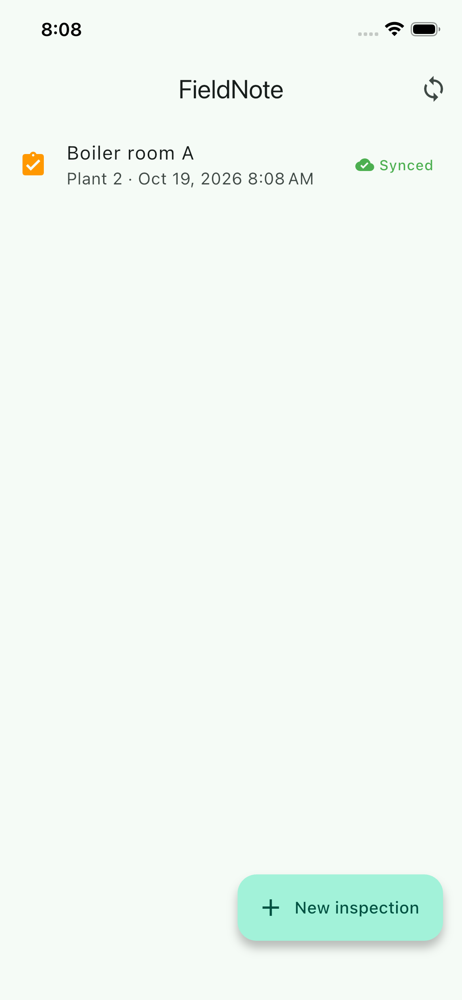
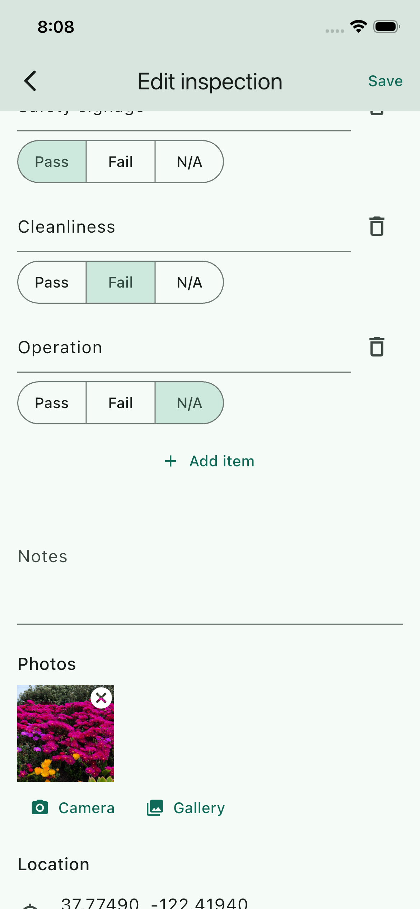
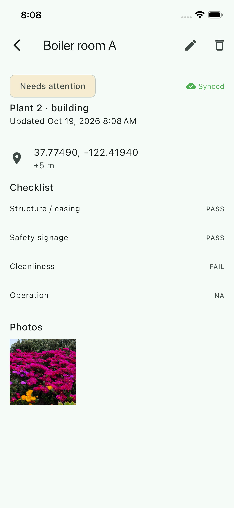
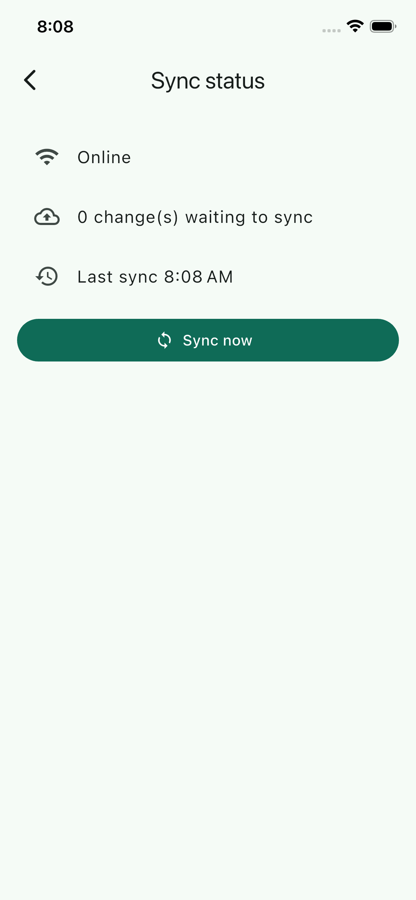

# FieldNote — Offline Inspection App

**Flutter · SQLite · Firebase · Background sync**

An app for technicians and field workers who inspect buildings, equipment or facilities in areas with poor internet. Everything works offline; data syncs on its own when the connection returns.

## Overview
- Complete inspection forms **offline**.
- Attach **photos** and **GPS coordinates**.
- **Sync automatically** when connectivity returns (foreground and background).
- Clear sync status on every record: pending, synced or failed.

**Demonstrates:** offline-first architecture, local storage, synchronization (outbox pattern, idempotent retries).

## Screenshots
| Inspection list | New inspection | Detail | Sync status |
|---|---|---|---|
|  |  |  |  |

> Captured on the iOS simulator after a successful sync to Firebase.

## Architecture
The UI only talks to SQLite. A sync engine drains an outbox table to Firebase in the background.

```
UI → Repository → SQLite (source of truth)
                     │ outbox
                     ▼
              Sync engine ──► Firestore (photos)
                          └─► Firestore (records)
```

Full detail: [architecture](docs/architecture.md) · [data model](docs/data-model.md) · [sync engine](docs/sync.md)

## Tech stack
| Area | Choice |
|---|---|
| Framework | Flutter (Dart ^3.9) |
| Local storage | SQLite (`sqflite`) |
| Remote | Cloud Firestore (records + compressed photos), Firebase Auth (anonymous) |
| Sync | Outbox + `connectivity_plus` + `workmanager` |
| Device | `image_picker`, `geolocator` |
| State | `provider` |

## How to use
1. Open the app and tap **New inspection**.
2. Fill in site, category and checklist; add notes.
3. Attach photos and capture your GPS location.
4. Save. It is stored on the device immediately, even with no signal.
5. When you're back online the record uploads automatically. Check the badge on the list, or open **Sync status** to force **Sync now** or retry failures.

## How to run
**Prerequisites:** Flutter stable, Xcode / Android Studio, Firebase CLI.

```bash
git clone <your-repo-url> && cd fieldnote
cp .env.example .env   # fill in your Firebase values
flutter pub get
flutter run
```

**Firebase** (project `fieldnote-5801c`). Config is read from a gitignored `.env` file; copy `.env.example` and fill it from the Firebase console (see [docs/firebase.md](docs/firebase.md)).

In the Firebase console enable Firestore and the Anonymous sign-in provider, and deploy `firestore.rules` — see [docs/firebase.md](docs/firebase.md).

**Try offline mode:** turn on airplane mode, create inspections, turn it off and watch them sync.

## Project structure
```
lib/
  core/{db,sync,remote,platform}/
  features/inspections/{domain,data,presentation}/
docs/            product, architecture, data, sync, firebase, dev guide
```

## Roadmap
See [docs/development.md](docs/development.md#roadmap).

## Docs
[Overview](docs/overview.md) · [Architecture](docs/architecture.md) · [Data model](docs/data-model.md) · [Sync](docs/sync.md) · [Firebase](docs/firebase.md) · [Development](docs/development.md)
